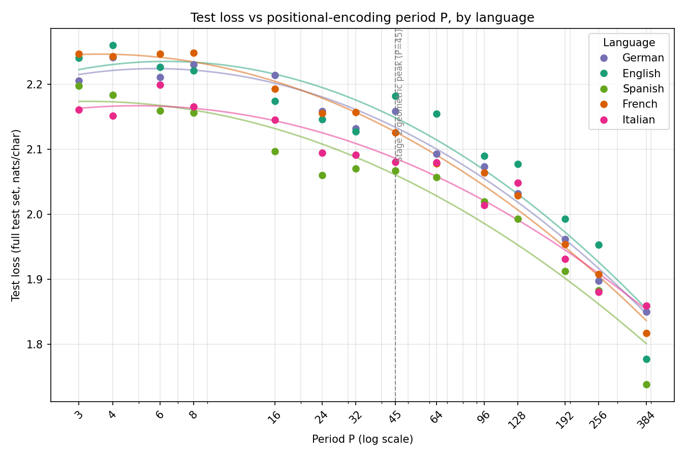

# Language Cadence: A Null Result


**Does tuning a positional encoding's period, language by language, make GPT pretraining better?** I built a transformer from scratch to test it. The short answer is no. The long answer is a cautionary tale about how easily a boundary effect can masquerade as a real result, and that part is more interesting than the short answer.

**📄 [Read the full write-up](writeup/writeup.pdf)**

## The idea

The standard positional encoding in transformers spreads frequencies evenly, with no regard for the language being modeled. This project asked a narrower question: what if the encoding is strictly periodic instead? Does tuning that period per language improve next-token prediction? Linguists sometimes claim that languages differ in rhythmic timing, and that claim gave the idea some loose motivation. But the test itself was purely empirical: does it lower pretraining loss?

## What happened

The period was swept across 14 values and five languages — English, French, German, Italian, and Spanish — for 70 training runs in total. Every language told the same story: test loss kept falling as the period grew, all the way out to the model's context length. That's not a tuned optimum. It's a boundary effect: a longer period just hands the model more usable context inside a fixed window, rather than encoding any real periodic structure.

A follow-up analysis confirmed it. The encoding was deliberately designed to penalize very long periods, on the theory that long periods make neighboring positions harder to distinguish. If that geometric property mattered for performance, distinguishability and test loss should move in opposite directions. They didn't. They were *positively* correlated across the sweep (Pearson r = +0.930) — the opposite of what the design predicted.

## Bottom line

This is a null result, and it's reported as one. The character-level tokenizer used here is the likely reason the underlying idea never got a fair test. The full story, including the mathematics behind the encoding, is in the write-up.



## Repo contents

- **[`writeup/writeup.pdf`](writeup/writeup.pdf)** — the paper. Start here.
- **[`docs/DESIGN_LOG.md`](docs/DESIGN_LOG.md)** — the implementation log: how the idea became code, stage by stage, with every design decision recorded along the way.
- **`src/language_cadence/`** — the data pipeline, positional encoding module, model, and training loop.
- **`scripts/`** — CLI entry points for each stage: data build, sweep, analysis.
- **`data/`, `results/`, `figures/`** — processed data, raw sweep results, and generated figures.
- **`tests/`** — unit tests (`python3 -m pytest tests/ -v`).

## Reproducing

```
python3 scripts/build_dataset.py     # Stage 1: raw archives -> processed windows
python3 -m pytest tests/ -v          # run all unit tests
python3 scripts/train_sweep.py       # Stage 4: the real (language, P, seed) sweep
python3 scripts/analyze_sweep.py     # Stage 5: summary + headline figure
```

See [`docs/DESIGN_LOG.md`](docs/DESIGN_LOG.md) for full details on the
data, architecture, and every implementation decision.
